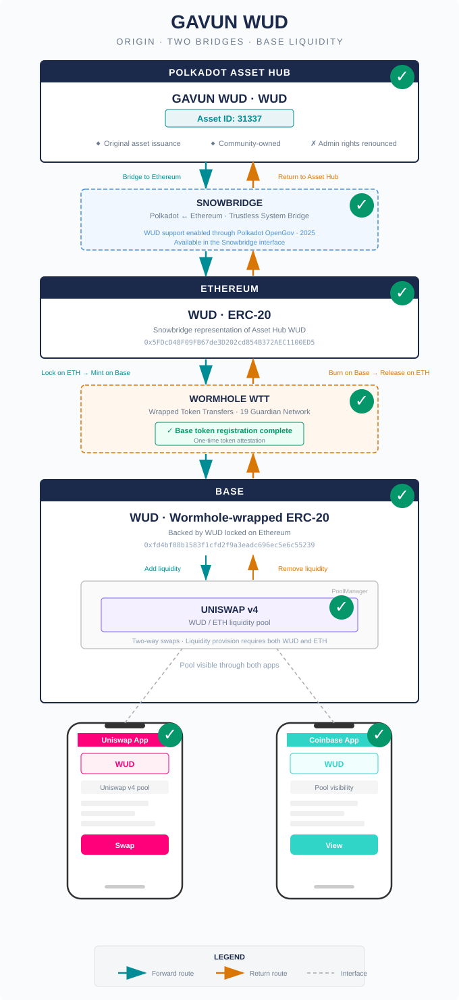

# GAVUN WUD — Technical Implementation

## 1. Overview

GAVUN WUD (symbol: WUD, 10 decimals) is a community-owned digital asset that originates on **Polkadot Asset Hub** as asset ID `31337`. The token's administrative rights have been renounced at the origin, making it a fully community-controlled asset.

To reach Base — an Ethereum L2 where it can participate in DeFi liquidity pools — WUD traverses two independent cross-chain bridges in sequence:

```
Polkadot Asset Hub ──► Snowbridge ──► Ethereum ──► Wormhole WTT ──► Base
   (asset 31337)                      (ERC-20)                    (wrapped ERC-20)
```

Each bridge leg is fully bidirectional. There is no direct Asset Hub → Base path; WUD must pass through Ethereum as an intermediary.

## Architecture Diagram

All components of this setup are fully deployed and thoroughly tested. The Wormhole WTT bridge is operational, the Uniswap v4 liquidity pool is live, and tokens flow bidirectionally across the entire route.

> **Remaining work:** The last open TODO is the GAVUN WUD website bridge UI — see [Chapter 7: TODOs for GAVUN WUD Website](#7-todos-for-gavun-wud-website).



*Origin · Two Bridges · Base Liquidity*

---

## 2. Bridge Comparison: Wormhole WTT vs Wormhole Axelar

| Property | Wormhole WTT | Wormhole Axelar |
|----------|--------------|-----------------|
| **Setup status** | DONE | TODO |
| **Setup time** | Hours — SDK + 2 scripts, one-time attestation | Longer — requires governance or partnership for new token support |
| **Security model** | 19 Guardians, 13/19 signing threshold | PoS validator set with stake-weighted voting |
| **Maintenance** | None — self-contained scripts | Relayer infrastructure or reliance on Axelar-operated relayers |
| **Bridge time** | ~15-20 min (Ethereum finality) | Similar, depends on validator polling |

**Why Wormhole WTT fits this project:** With a small team, a community-driven token, and a ~600k market cap, the priority is fast setup and zero ongoing maintenance. Wormhole WTT required writing two scripts and a one-time attestation — the entire Ethereum-to-Base bridge was operational in an afternoon. Wormhole Axelar offers a larger validator set, but the added security is disproportionate to the value at risk, and the integration overhead is higher. Snowbridge (Asset Hub to Ethereum) is a given — it is the only trustless path from Polkadot to Ethereum.

### Security Incident History

| | Snowbridge | Wormhole | Axelar |
|--|-----------|----------|--------|
| **Exploited?** | No | Yes (Feb 2022) | Yes (Jun 2026) |
| **Loss** | $0 | $326M | $4.67M |
| **Root cause** | N/A — audit findings fixed proactively | Solana-specific signature bypass (patched) | IBC channel origin not verified on Secret Network |

Snowbridge has never been exploited. Wormhole's 2022 hack was a Solana-specific vulnerability (`load_instruction_at` bypass) that does not affect the Ethereum-to-Base EVM path used by WUD — Jump Trading covered the $326M loss and the issue was patched. Axelar's more recent exploit (June 2026) hit an IBC route to Secret Network where a modified contract failed to verify the origin channel, allowing an attacker to mint unbacked tokens from a single-validator Cosmos chain. Neither Wormhole nor Axelar has had an EVM-to-EVM bridge exploit.

### Contract Addresses

| Asset | Chain | Address |
|-------|-------|---------|
| WUD (origin) | Polkadot Asset Hub | Asset ID `31337` |
| WUD (ERC-20) | Ethereum | `0x5FDcD48F09FB67de3D202cd854B372AEC1100ED5` |
| WUD (wrapped) | Base | `0xfd4bf08b1583f1cfd2f9a3eadc696ec5e6c55239` |

### Bridge Infrastructure

| Contract | Chain | Address |
|----------|-------|---------|
| Wormhole Token Bridge | Ethereum | `0x3ee18B2214AFF97000D974cf647E7C347E8fa585` |
| Wormhole Token Bridge | Base | `0x8d2de8d2f73F1F4cAB472AC9A881C9b123C79627` |
| Wormhole Core Bridge | Base | `0xbebdb6C8ddC678FfA9f8748f85C815C556Dd8ac6` |

---

## 3. Bridge 1: Snowbridge (Polkadot Asset Hub ↔ Ethereum)

### What is Snowbridge

Snowbridge is a general-purpose, trustless, and decentralized bridge between Polkadot and Ethereum. It is a system bridge — part of the Polkadot SDK itself — owned by the Polkadot community with no token, no multisigs, and no centralized operator.

WUD support on Snowbridge was enabled through **Polkadot OpenGov** governance in 2025.

### Verification Architecture

Snowbridge achieves trustlessness through **on-chain light clients on both sides**:

#### Ethereum → Polkadot (Ethereum Light Client)

An Ethereum Beacon Chain light client is implemented as a Substrate pallet (`ethereum-beacon-client`) on BridgeHub. It uses the **Altair Sync Protocol** to:

- **Track finalized beacon blocks** stored as checkpoints
- **Store execution headers** that are ancestors of finalized headers, using their `receiptsRoot` to verify messages
- **Verify sync committee signatures** — a subset of Ethereum validators (512 validators per sync committee period of ~27 hours) that sign beacon blocks using BLS signatures
- **Validate incoming events** with transaction receipt proofs (Merkle proofs showing a transaction was included in the chain and emitted a particular event)

#### Polkadot → Ethereum (BEEFY Light Client)

A Polkadot light client on Ethereum implements the **BEEFY consensus protocol**. Since verifying all Polkadot validator signatures on-chain would be prohibitively expensive, it uses **random sampling**:

1. **`submitInitial`** — submits a BEEFY commitment, one randomly selected validator signature, and a bitfield of claimed signers
2. **`commitPrevRandao`** — after a waiting period, commits to a seed derived from Ethereum's RANDAO for unpredictable sampling
3. **`submitFinal`** — supplies signatures for the sampled validators, verified against the current validator set

Security is cryptoeconomic: validators can be slashed for signing fraudulent commitments (50% stake slash via fisherman-submitted equivocation proofs).

#### Relayers

Relayers are **permissionless and trustless** off-chain agents that pass messages between chains:

- **Polkadot → Ethereum:** BEEFY relay (signed commitments and proofs) + Message relay (message commitments from BridgeHub)
- **Ethereum → Polkadot:** Header relay (beacon chain headers, execution headers, sync committees) + Message relay (outbound channel contract events)

Anyone can operate a relayer. Since relayers are untrusted, security derives entirely from the on-chain light client verification.

### WUD on Snowbridge

When WUD (asset 31337) is bridged from Asset Hub to Ethereum via Snowbridge:

1. WUD tokens are locked/reserved on Asset Hub
2. A cross-chain message is sent through BridgeHub to Ethereum
3. The Ethereum Gateway contract verifies the message via the BEEFY light client
4. The ERC-20 WUD token (`0x5FDcD48F09FB67de3D202cd854B372AEC1100ED5`) is minted on Ethereum

The reverse direction burns the ERC-20 and releases the original asset on Asset Hub.

---

## 4. Bridge 2: Wormhole WTT (Ethereum ↔ Base)

### What is Wormhole WTT

Wormhole Wrapped Token Transfers (WTT) is a lock-and-mint / burn-and-release bridge protocol secured by a network of **19 Guardian nodes**. Unlike Snowbridge's light-client approach, Wormhole relies on a distributed validator set that independently observes and attests to cross-chain events.

### Guardian Network

- **19 Guardians** run as distributed nodes monitoring the state of supported blockchains
- **Signing threshold:** 13 of 19 (supermajority) Guardian signatures required to produce a valid VAA
- **Full observation:** On Ethereum, all 19 Guardians run full nodes and independently observe on-chain events
- Guardians sign payloads independently; signatures accumulate until the 13/19 threshold is reached

### VAA (Verified Action Approval)

The VAA is Wormhole's core messaging primitive — a signed packet of cross-chain data. Structure:

**Header:**
- `version` (byte)
- `guardian_set_index` (u32)
- `len_signatures` (u8)
- `signatures` — each containing an `index` (u8) and 65-byte ECDSA signature

**Body:**
- `timestamp`, `nonce`, `emitter_chain` (u16), `emitter_address` (32 bytes)
- `sequence` (u64), `consistency_level` (u8)
- `payload` (bytes) — layout depends on the application

**Signing:** The body is double-hashed with keccak256: `digest = keccak256(keccak256(body))`, then signed with ECDSA.

**Payload types relevant to WTT:**
- `payload_id: 1` — Token Transfer
- `payload_id: 2` — Attestation (token metadata registration)
- `payload_id: 3` — Token Transfer with Message

### Token Attestation (One-Time Setup)

Before WUD could be transferred from Ethereum to Base, a one-time **attestation** was required to register the token on Base's Token Bridge. This was performed following the [Wormhole Attest Tokens Guide](https://wormhole.com/docs/products/token-transfers/wrapped-token-transfers/guides/attest-tokens/).

#### Step 1: Create attestation on Ethereum

Called `createAttestation` on Ethereum's Token Bridge contract, which emits a Wormhole message containing WUD's metadata (name: "GAVUN WUD", symbol: "WUD", decimals: 10).

- **Attestation tx:** `0x0de0596502ed6423d88349548c3091cfa7818b16c8864295aa07fc3c623267d1`
- **Wormhole sequence:** `693856`

#### Step 2: Guardian signing

The 19-Guardian network observed the attestation transaction on Ethereum, waited for finality (~15 minutes on Ethereum mainnet), and produced a signed `TokenBridge:AttestMeta` VAA with 13/19 signatures.

#### Step 3: Submit attestation on Base

The signed VAA was submitted to Base's Token Bridge contract (`0x8d2de8d2f73F1F4cAB472AC9A881C9b123C79627`), which deployed a new wrapped ERC-20 contract for WUD on Base.

- **Submission tx:** `0x34f9826dc7a1033db363d0262407dff75a905dee5fc74fc2899074abf574d982`
- **Wrapped WUD address on Base:** `0xfd4bf08b1583f1cfd2f9a3eadc696ec5e6c55239`

#### Gas estimation issue

The Wormhole SDK v4.14.1 underestimated gas for the Base submission. The SDK's default gas limit was ~489,000, but the `createWrapped` call on Base's Token Bridge required ~760,000 gas. This was resolved by sending the transaction manually with an adequate gas limit (see `submit-attest.ts` in this repository).

### Transfer Flow: Ethereum → Base

```
1. User calls transfer on Ethereum
   └─► WUD tokens locked in Ethereum Token Bridge (0x3ee1...)

2. Wormhole Guardians observe and sign
   └─► 13/19 Guardians sign the transfer VAA (~15-20 min for Ethereum finality)

3. User redeems on Base
   └─► VAA submitted to Base Token Bridge (0x8d2d...)
   └─► Wrapped WUD minted to destination address
```

### Transfer Flow: Base → Ethereum

```
1. User calls transfer on Base
   └─► Wrapped WUD burned by Base Token Bridge

2. Wormhole Guardians observe and sign
   └─► 13/19 Guardians sign the transfer VAA

3. User redeems on Ethereum
   └─► VAA submitted to Ethereum Token Bridge
   └─► Original WUD unlocked to destination address
```

---

## 5. Base Liquidity: Uniswap v4

With WUD available on Base as a wrapped ERC-20, it participates in DeFi through a **Uniswap v4 liquidity pool** on Base. The pool is live and active.

### Uniswap v4 Architecture

Uniswap v4 introduces the **singleton PoolManager** contract, where all pools live within a single contract rather than having individual pair contracts. Key features:

- **Native ETH support** — pools can use ETH directly without wrapping

### WUD / ETH Pool (Active)

The WUD / ETH liquidity pool is deployed and operational within the Uniswap v4 PoolManager on Base:

- **Pair:** WUD / ETH
- **Status:** Active — swaps and liquidity provision are live
- Two-way swaps between WUD and ETH
- Liquidity provision requires both WUD and ETH
- Pool visible through the Uniswap app and Coinbase Wallet (both interfaces display the same on-chain pool)

---

## 6. Implementation Details

### Technology Stack

- **Runtime:** Node.js with TypeScript (`tsx`)
- **SDK:** `@wormhole-foundation/sdk` v4.14.1
- **EVM interaction:** `ethers` v6
- **Key management:** Environment variables via `dotenv` (MetaMask-compatible private keys)

### Scripts

| Script | Purpose |
|--------|---------|
| `attest.ts` | Full attestation flow (one-time per token/chain pair) |
| `submit-attest.ts` | Submit attestation VAA on Base with adequate gas |
| `resume-attest.ts` | Resume from a known source tx — fetch VAA and submit |
| `transfer-eth-base.ts` | Bridge WUD from Ethereum to Base |
| `transfer-base-eth.ts` | Bridge WUD from Base back to Ethereum |
| `helper.ts` | Shared signer factory for EVM chains |

### Key SDK Functions

```typescript
// Initialize Wormhole with EVM platform
const wh = await wormhole("Mainnet", [evm]);

// Token attestation
const tb = await sourceChain.getTokenBridge();
const attestTxs = tb.createAttestation(token, payer);
await signSendWait(sourceChain, attestTxs, signer);

// Fetch signed VAA from Guardian network
const vaa = await wh.getVaa(message, "TokenBridge:AttestMeta", timeout);

// Submit attestation on destination
const destTb = await destinationChain.getTokenBridge();
destTb.submitAttestation(vaa, payer);

// Token transfer
const xfer = await wh.tokenTransfer(tokenId, amount, from, to, "TokenBridge");
await xfer.initiateTransfer(sourceSigner);
await xfer.fetchAttestation(timeout);
await xfer.completeTransfer(destSigner);
```

---

## 7. TODOs for GAVUN WUD Website

- [ ] **Implement Wormhole bridge UI for bidirectional WUD transfers (Ethereum ↔ Base)**

  The official Wormhole Portal does not list WUD in their interface. A custom bridge UI must be built into the GAVUN WUD website. This is significantly more work than the scripts in this repo — those use private keys directly, but a website must integrate with browser wallets (MetaMask, Coinbase Wallet) via wallet-connect, where the user signs transactions with their public key and the wallet handles signing.

  **Two approaches:**

  1. **Wormhole Connect widget** (recommended for faster setup) — a drop-in React component (`@wormhole-foundation/wormhole-connect`) that handles wallet connection, token selection, and the full transfer flow. WUD can be whitelisted via the `tokensConfig` prop so only WUD appears in the UI.
     - Package: [`@wormhole-foundation/wormhole-connect`](https://www.npmjs.com/package/@wormhole-foundation/wormhole-connect)
     - Demo repo: [`wormhole-foundation/demo-basic-connect`](https://github.com/wormhole-foundation/demo-basic-connect)
     - Configuration docs: [Wormhole Connect Configuration](https://wormhole.com/docs/build/transfers/connect/configuration/configure-data)
     - React tutorial: [Wormhole Connect React dApp](https://wormhole.com/docs/tutorials/connect/react-dapp)

  2. **Custom UI with the Wormhole TypeScript SDK** — build your own transfer interface using `@wormhole-foundation/sdk` with a browser wallet signer instead of a private key signer. This gives full control over the UI but requires implementing the wallet adapter, transaction flow, and VAA polling yourself.
     - SDK repo: [`wormhole-foundation/wormhole-sdk-ts`](https://github.com/wormhole-foundation/wormhole-sdk-ts)
     - SDK reference (signer interfaces): [Wormhole SDK Reference](https://wormhole.com/docs/tools/typescript-sdk/sdk-reference)
     - Token Bridge tutorial: [Tokens via Token Bridge](https://wormhole.com/docs/tutorials/typescript-sdk/tokens-via-token-bridge)

---

## 8. References

- [Wormhole Attest Tokens Guide](https://wormhole.com/docs/products/token-transfers/wrapped-token-transfers/guides/attest-tokens/)
- [Wormhole Transfer Wrapped Assets Guide](https://wormhole.com/docs/products/token-transfers/wrapped-token-transfers/guides/transfer-wrapped-assets/)
- [Wormhole TypeScript SDK](https://www.npmjs.com/package/@wormhole-foundation/sdk) — v4.14.1
- [Wormhole SDK GitHub](https://github.com/wormhole-foundation/wormhole-sdk-ts)
- [Wormhole Supported Networks](https://wormhole.com/docs/build/start-building/supported-networks/)
- [Wormhole Guardian Documentation](https://wormhole.com/docs/protocol/infrastructure/guardians/)
- [Wormhole VAA Specification](https://wormhole.com/docs/protocol/infrastructure/vaas/)
- [Wormhole Explorer (Wormholescan)](https://wormholescan.io/)
- [Snowbridge Documentation](https://docs.snowbridge.network/)
- [Snowbridge Architecture — Ethereum Verification](https://docs.snowbridge.network/architecture/verification/ethereum)
- [Snowbridge Architecture — Polkadot Verification](https://docs.snowbridge.network/architecture/verification/polkadot)
- [Polkadot Wiki](https://wiki.polkadot.com/)
